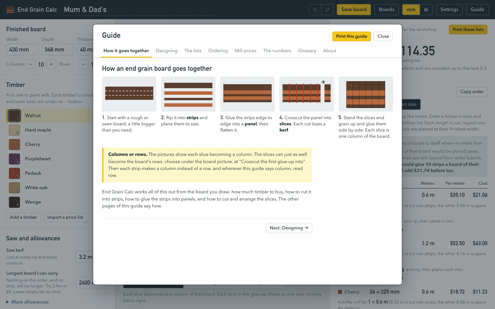
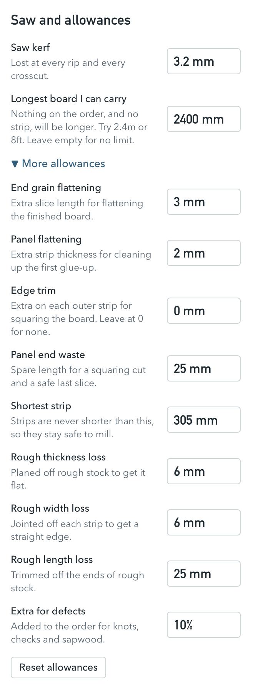

# End Grain Calc

Lay out an end grain chopping board on screen, then get everything you need
to build it: the order for the mill, a milled cutting list, a drawing of each
glue-up and the order of work, with the cost.


It is one small Rust program. It runs as an app in its own window on a Mac,
Windows or Linux, or in your web browser, and does all the maths itself;
nothing leaves your machine.

- Works in millimetres or inches, and in any currency.
- Orders timber by the board foot, or in sawn sizes by the metre for mills
  that sell that way.
- Takes your own mill's prices: type them in, or import a whole price list.
- Prints a workshop sheet with the board, the order, the cuts and the
  glue-ups.

**Check the numbers before you buy timber or cut it.** End Grain Calc is a
free tool and it can be wrong, and your saw, your timber and your mill will
not match its assumptions exactly. It comes with no warranty, and the author
takes no responsibility for errors or for anything that follows from using
it. See the [licence](#licence).

There are no ready-made downloads yet, so for now it is built from source.
That needs [Rust](https://rustup.rs) and a copy of this repository. Each
section below has one script to run from the repository's folder.

## Contents

- [Run it as a Mac app](#run-it-as-a-mac-app)
- [Run it as a Windows app](#run-it-as-a-windows-app)
- [Run it as a Linux app](#run-it-as-a-linux-app)
- [Run it in a browser](#run-it-in-a-browser)
- [First run and Settings](#first-run-and-settings)
- [Designing a board](#designing-a-board)
- [What you get](#what-you-get)
- [Two ways to write the order](#two-ways-to-write-the-order)
- [Your mill's prices](#your-mills-prices)
- [Where things are kept](#where-things-are-kept)
- [How the numbers are worked out](#how-the-numbers-are-worked-out)
- [Code, and other platforms](#code-and-other-platforms)
- [Licence](#licence)

## Run it as a Mac app

```bash
./scripts/bundle-mac.sh
```

That builds `dist/End Grain Calc.app`. Double-click it, or drag it to
Applications. There is no server and no port: the window talks to the engine
directly.

The script signs the app only for the Mac it was run on, and builds it for
that Mac's processor (Apple silicon or Intel), not both. On that Mac it opens
like any other app. Copied to a different Mac, macOS may refuse to open it
the first time: right-click it and choose Open, or on recent versions of
macOS allow it under System Settings > Privacy & Security.

## Run it as a Windows app

```bat
scripts\build-windows.cmd
```

That builds `dist\End Grain Calc\End Grain Calc.exe`. Double-click it, or
move that folder wherever you like and make a shortcut to it.

- **What it needs.** Rust for Windows, whose installer also offers Microsoft's
  C++ build tools (say yes; Rust needs them). The window is drawn by
  Microsoft's WebView2, which is part of Windows 11 and is on most Windows 10
  machines already.
- **Not signed.** Copied to a different PC, Windows may show "Windows
  protected your PC" the first time: choose "More info", then "Run anyway".
- **No menu bar.** Everything is on buttons in the window, and the usual
  shortcuts work (Ctrl+S, Ctrl+Z, Ctrl+C and so on). The .exe does not have
  its own icon yet.
- **Not tried on a real PC yet.** The Windows code compiles, but nobody has
  run it. If it does not start, [run it in a browser](#run-it-in-a-browser)
  instead, and please say what happened.

## Run it as a Linux app

```bash
./scripts/build-linux.sh
```

That builds `dist/end-grain-calc/endgrain`; run that file to open the app. To
add it to your applications menu:

```bash
./scripts/build-linux.sh --install
```

This copies the app, its icon and a menu entry into `~/.local` in your home
folder, so it needs no sudo. `--uninstall` takes them out again and leaves
your boards alone.

- **What it needs.** The window is drawn by WebKitGTK, so the WebKitGTK 4.1
  (version 2.40 or newer) and GTK 3 development files have to be installed
  to build it. If they are
  missing the script stops and gives the install line for Debian and Ubuntu,
  Fedora, and Arch.
- **No menu bar.** Everything is on buttons in the window, and the usual
  shortcuts work.
- **Lightly tested.** It has been built, installed and started on Debian 12
  in a container with a virtual screen, where the window loaded the designer
  and calculated a board. Nobody has used it on a real Linux desktop yet.

## Run it in a browser

```bash
cargo run --release -- --browser
```

Your browser opens at http://127.0.0.1:7878/. Stop it with Ctrl+C.

On Linux without WebKitGTK, and on Windows, use the browser-only build
instead, which leaves the window out altogether:

```bash
cargo run --release --no-default-features
```

`cargo run --release` on its own opens the app window without bundling.
Other options: `--port <n>`, `--no-open`, `--data <dir>` (keep boards and
settings somewhere other than `~/.endgrain`), `--dev` (load `ui/` from disk
while editing it) and `--trace` (print each request).

## First run and Settings

The app comes with two timbers (walnut and cherry) and no prices, because
every mill's prices and sizes are different. The first time it opens it asks
four things, all of which can be skipped and changed later under **Settings**:
the currency symbol, millimetres or inches, whether your mill sells by the
board foot or in sawn sizes by the metre, and the tax to add. The currency
symbol applies everywhere; the other three are what a new board starts with.

## Designing a board

The board is a grid of rows and columns, seen from above. Set its finished
width, depth and thickness and the number of rows and columns on the left.

- **Paint.** Pick a timber, then click a cell or drag across several. Keys 1
  to 9 pick the first nine timbers.
- **Size.** Click the yellow tape beside a row or above a column to type its
  size, or drag the joins between them. Drag a row or column along the tape
  to move it.
- **Pinned and not pinned.** A size you type or drag is pinned: it stays put,
  and the tape shows it in bold on a darker band with a pin. The rest share
  whatever is left over equally. The popup for each row or column has a
  **Not pinned | Pinned** switch.
- **Undo and redo.** The two arrow buttons in the header, or Cmd+Z and
  Shift+Cmd+Z (Ctrl on Windows and Linux).
- **Units.** The mm/in switch in the header changes a board's units at any
  time; Settings chooses what new boards start in.
- **Timbers.** Each timber's "···" button opens its colour, its price by the
  board foot with the thickness to buy it as, and its sawn sizes with prices
  per metre. "Add a timber" adds your own.

If something does not add up, such as pinned sizes that leave no room for the
rest, a note above the board says what is wrong and offers a fix.

### Saving

**Save board** (or Cmd+S) saves under the board's name. **Boards** lists your
saved boards and has "New board" and "Duplicate this board". The app asks
before closing, or opening another board, with unsaved changes.

## What you get

The right-hand side updates as you design.

- **Order from the mill**, with the cost. See "Two ways to write the order"
  below. "Copy order" puts it on the clipboard as plain text for an email.
- **Milled cutting list.** Every strip, with its finished thickness and width,
  the width to rip it at before planing, its length and the panel it goes
  into.
- **Glue-ups.** A drawing of each panel with its strips numbered and sized,
  drawn the way the board faces: strips run left to right when slices become
  columns, and top to bottom when they become rows.
- **Order of work.** The steps from the mill to the finished board.


Under the board picture, **Crosscut the first glue-up into** chooses whether
each slice becomes a column or a row of the board. "Whichever needs fewer"
picks the way with fewer glue-ups.

**Print these lists** prints the board with all of the above (File > Print
Lists does the same in the Mac app). The board's picture and summary share
the top of the first page and the lists run on from there, with about 14 mm
of margin. The **Guide** button shows how an end grain board goes together as
a picture, explains the terms used (strip, panel, slice, kerf, pinned, rip at
and so on), and can be printed on its own.



## Two ways to write the order

The "Order from the mill" list has a switch:

- **By the board foot.** Rough stock by timber and thickness (4/4, 8/4 and so
  on), priced per board foot.
- **By sawn size.** For mills that sell fixed sawn sections by the metre, such
  as 50 x 150 mm. The calculator works out which sections and how many metres
  to buy and which lengths to ask for. Under each line it gives the cuts:
  how many pieces to crosscut and how long, then the width to rip each strip
  at and the size to plane it to. Tax (VAT, GST or sales tax, at a rate you
  set) is added on top.

In "By sawn size", a timber with no sawn sizes entered stays on the board
foot list. A strip too big for every sawn size its timber comes in is left
off the order, with the reason and the largest size that would fit. Tick
"Order these by the board foot" beside that list if you would rather have a
mixed order.

Until a timber has a price, the order shows "add a price" beside it rather
than a zero; clicking it opens that timber's editor.

How a sawn order is worked out: each strip goes to the cheapest section thick
enough for it (flat or on edge) once the rough allowances are added. Strips of
the same length are then packed side by side across each available board
width, with a kerf between them, and the cheapest combination is kept after
adding the extra for defects and rounding up to the step the mill sells in
(0.3 m, or your price list's step, unless you change it). The lengths to ask
for are rounded up to that step too and include the extra for defects, so
they add up to the metres on the order. Quantity price breaks are not
modelled.

**Avoid ripping** (a tick box in "By sawn size") gives a strip a whole sawn
board to itself, planed to size, whenever a section exists that would lose no
more than the stated share of the board (50% unless you change it). Strips too
thin for that are still ripped from wider boards. The note beside it says how
many strips get their own board and what that adds to the cost.

**Longest board I can carry** (under "Saw and allowances") caps the length of
everything: glue-ups are split into shorter panels if their strips would be
too long, and no board on the order is longer. Enter it as 2.4m, 8ft or in the
board's own units.

## Your mill's prices

To fill in a whole mill at once, use **Import a price list** (under the timber
list, or in Settings):

1. "Copy the prompt" and give it to an AI assistant that can read web pages,
   with your mill's website. The prompt describes the format below.
2. Paste what it returns into the box (or choose the file) and press "Read
   this price list".
3. Tick the timbers you use. Their prices go onto your timber list; ones you
   don't have yet are added. Check a few against the mill's own list, since an
   assistant can misread a page.

A price list is a JSON file. Only `timbers` is required:

```json
{
  "mill": "Hill Sawmill",
  "source": "https://example.com/prices",
  "fetched": "2026-11-12",
  "step_m": 0.3,
  "timbers": [
    {
      "name": "American black walnut",
      "color": "#5a3d2b",
      "price_per_bf": 0,
      "sizes": [{ "thickness": 26, "width": 150, "price_per_m": 24.5 }]
    }
  ]
}
```

`sizes` are nominal sawn sections in millimetres with a price per metre before
tax; `price_per_bf` is for mills that sell by the board foot; `step_m` is the
step of length the mill sells in. `examples/hill-sawmill.json` is a complete
one to try the import with; the mill and its prices are invented. Prices
already on your timbers stay as they are until you tick them again under
"Import a price list".

## Where things are kept

Everything is a plain JSON file in `~/.endgrain`, a folder in your home
folder (on Windows, `.endgrain` in your user folder, such as
`C:\Users\you\.endgrain`):

- `boards/`: one file per board
- `timber.json`: your timber list (names, colours, prices, sawn sizes,
  preferred stock thickness)
- `prefs.json`: your settings
- `mill-prices.json`: your mill's price list, once imported. You can also put
  a file there yourself

## How the numbers are worked out

The board is built the usual way: strips are glued into a panel, the panel is
crosscut into slices, and the slices are stood end grain up and glued side by
side. Each slice is one column (or one row, your choice) and each strip in it
is one cell. The rules below are written for slices as columns; for rows,
swap the two words.

- **Panels.** Columns with the same width and the same run of timbers come
  from one panel. A column that is another one upside down shares its panel
  too (the slice is flipped), provided the row sizes are symmetrical. That is
  how a checkerboard comes from a single glue-up.
- **Strip length** = slices x (board thickness + end grain flattening)
  + (slices + 1) x kerf + panel end waste, and never less than the shortest
  strip you allow.
- **Strip thickness** = column width + panel flattening.
  **Strip width** = row size, plus the edge trim on the two outer strips if
  you set one (it starts at zero).
- **Rough stock** for a strip = strip size + rough allowances, plus one kerf
  on the width for the rip. Board feet use the nominal thickness (8/4 = 2").
  A strip is taken flat or on edge, whichever uses less timber, and each
  timber is kept to one stock thickness unless mixing saves more than 10%.
  Pin a thickness per timber with "Buy as".
- **Rip at.** Strips are ripped oversize and planed down: the cutting list
  and the sawn order give the width to rip at (finished size plus the rough
  width loss) beside each finished size.
- **Whole millimetres.** On a board in millimetres every allowance except the
  saw kerf is kept to a whole millimetre, and strip lengths are rounded up to
  one, so no cut size has a decimal. If unpinned rows or columns share out to
  a fraction the designer offers the nearest board sizes that give whole ones.
- **Board foot order** = net board feet + your extra for defects (20% unless
  you change it), times your price.

All of these allowances are under "Saw and allowances" and are saved with the
board. "Reset allowances" puts them back to the starting values for the
board's units.



## Code, and other platforms

- `src/lib.rs`, `src/calc.rs`, `src/model.rs`: the engine. Plain Rust with no
  files, network or windows. Tests: `cargo test`
- `src/store.rs`: board, timber, settings and price list files
- `src/api.rs`: answers the designer's requests, however they arrive
- `src/window.rs`: the app window (tao + wry)
- `src/server.rs`: browser mode (tiny_http)
- `ui/`: the designer (HTML, CSS, JS), built into the binary
- `scripts/bundle-mac.sh`, `scripts/build-windows.cmd`,
  `scripts/build-linux.sh`: build the app for each system
- `scripts/make_icon.py`: draws the app icon
- `examples/hill-sawmill.json`: an example price list for an invented mill,
  also used by the tests. It is not built into the app

The layers are split so the same code can go further later:

- **Windows and Linux.** tao and wry cover both (WebView2 and WebKitGTK), and
  each has a build script above. Still missing: an installer or package for
  each, a menu bar (only macOS has one here), an icon inside the Windows
  .exe, and testing on real machines.
  `cargo build --release --no-default-features` gives a browser-only binary
  with no window libraries at all.
- **A hosted web version.** The engine is written to compile to WebAssembly,
  and the designer reaches it through one function (`api()` in `ui/app.js`).
  A web build would swap that function for direct calls to
  `endgrain::calculate_json` and keep boards in the browser's storage instead
  of files. This has not been built or compiled yet.

## Licence

Made with love for woodworkers by [TEA JAY HAN](https://teajayhan.com).

End Grain Calc is shared under the [MIT licence](LICENSE): you may use, copy,
change and share it, including in your own work, as long as the copyright
notice (which names the author) and the licence text stay with every copy or
substantial part of it.

It is provided as it is, with no warranty of any kind. The author is not
liable for any loss or damage that comes from using it, including wasted
timber or money from numbers that turn out to be wrong. The licence text has
the full wording.

The TEA JAY HAN name and logo (`assets/teajayhan-*.svg`, and where they appear
in the app) identify the maker and are not covered by that licence. If you
share a changed version, keep the credit to the original author but do not
present your version as TEA JAY HAN's.
